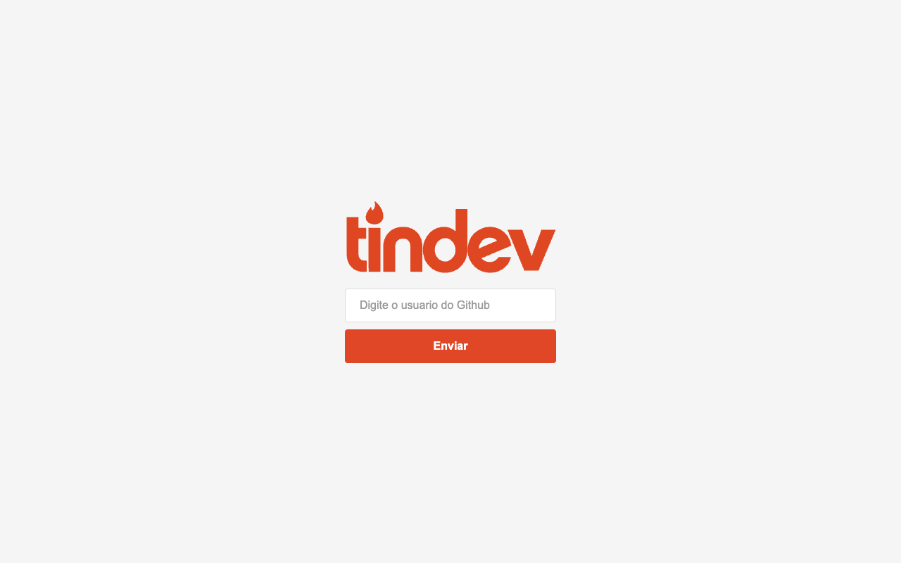

# 🔥 Tindev

"Tinder para desenvolvedores": o dev entra com o usuário do GitHub, vê outros devs cadastrados e pode dar *like* ou *dislike*. Construído durante a **Semana OmniStack 8 (Rocketseat)**.



## Estrutura (monorepo)

| Pasta | Stack |
| --- | --- |
| [`backend/`](backend) | Node.js, Express, Mongoose (MongoDB), Axios (API do GitHub) |
| [`frontend/`](frontend) | React, React Router, Axios |

## Endpoints da API

| Método | Rota | Descrição |
| --- | --- | --- |
| `GET` | `/devs` | Lista devs ainda não avaliados pelo usuário |
| `POST` | `/devs` | Cadastra um dev a partir do usuário do GitHub |
| `POST` | `/devs/:devId/likes` | Registra um like |
| `POST` | `/devs/:devId/dislikes` | Registra um dislike |

## Como rodar

Requer Node.js e uma instância MongoDB acessível (ajuste a string de conexão em `backend/src/server.js`).

```bash
cd backend && npm install && npm run dev
cd frontend && npm install && npm start
```

## Autor

Feito por [Amós Magalhães](https://github.com/amslimaa).
